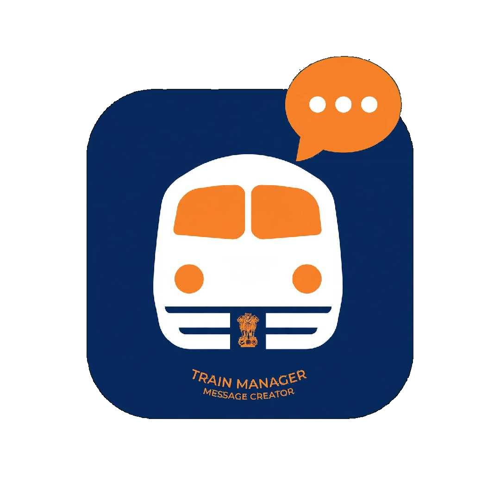

# 🚂 Train Manager - Message Creator
### Railway Control Message Generator V9 FINAL - QuickBar SafetyYellow

Offline PWA for Train Managers, Guards & Controllers (SC Division - BZA).

**Live Demo:** `https://YOUR_USERNAME.github.io/train-manager/`

### Features
- ✅ QuickBar SafetyYellow for fast message building
- ✅ Train number auto-lookup (TRAIN_DB + custom saves)
- ✅ Night Mode + High-Contrast Outdoor Mode for sun
- ✅ Font size control (A- / A+)
- ✅ Telugu & Hindi (Devanagari) support
- ✅ Auto Backup at 22:00 to localStorage + download
- ✅ Copy / Share / PDF export
- ✅ 100% Offline - Works as PWA

### Install as App
1. Open GitHub Pages link in Chrome on Android
2. Tap ⋮ → Add to Home Screen
3. Logo with Train + Ashoka Emblem will appear

### Files
- `index.html` - Main app (single file, 425KB)
- `manifest.json` - PWA manifest
- `icon-192.png` / `icon-512.png` - App icons
- `apple-touch-icon.png` - iOS icon
- `sw.js` - Service Worker for offline
- `logo.png` - Original branding

### GitHub Pages Setup
1. Create repo `train-manager` on GitHub
2. Upload all files to `main` branch root
3. Settings → Pages → Source: main / root → Save
4. Your app will be live in 1-2 minutes

### Branding
- Navy: `#0a1f44` / `#0b2a5b`
- Safety Orange: `#f57c00` / `#f59e0b`
- White train + Orange speech bubble

Built for Indian Railways - BZA Division.
